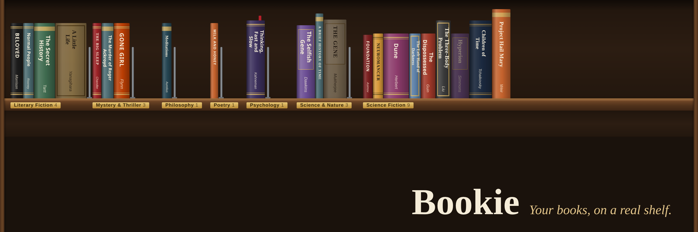
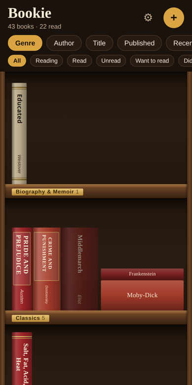

# Bookie



A reading tracker that shows your library as a virtual bookshelf. Swipe along shelves and up and down the bookcase. Book thickness follows page count and height follows the book's physical size. Shelves can be grouped by genre, author, title, publish date or recently read.

**[Try it live → mybookie.pages.dev](https://mybookie.pages.dev)** (an early prototype, free, no account needed)

<p>
  
  &nbsp;
  
</p>

## What it does

- **Real-size books.** Each spine's thickness comes from the page count and its height from the book's physical size. Colours come from the cover's most common colours, with a second colour when the cover has one.
- **Swipe around the shelves.** Sideways along a shelf, up and down the bookcase. Shelves group by genre, author, title, publish date or what you read recently, and long groups are split into ranges (A–D, E–G…) about a screen wide.
- **Pull a book off the shelf.** Tap a spine and the book comes out of the shelf, turns from its spine to its cover and lands on its page; going back puts it back in its gap. Tap the cover on the page to see it big.
- **Track your reading.** Reading, read, unread, want to read, did not finish, with ratings, dates and notes. A book you're reading gets a bookmark.
- **Own it or not.** Books you don't own are faded. Starting a book you wanted asks whether it's on your shelf now.
- **Get books in.** Search, barcode scan, type them in, import a Goodreads export, or start with a sample library. Duplicates can be merged.
- **Make it yours.** Pick a cover from any edition Open Library knows, upload your own photo, or keep a plain cloth cover. Type the title and author straight onto the cover, and add your own genres. Fields check what you type: real dates, a sensible year, a valid ISBN.
- **Keeps your data with you.** Everything is stored on the device in SQLite, and that's the default. Export and restore a backup from Settings.
- **An account if you want one.** Sign up with a username and a passkey or a password to keep your library in sync across devices, stored in the EU. Nothing leaves the device without one.
- **Friends' library.** Add friends by username and walk down a hallway of their bookcases. Friends see your books, never your notes, ratings or reading dates, and you can hide your shelf.
- **Works as an app.** Runs on the web and can be added to a phone's home screen, and runs in Expo Go.

## Built with

Expo (SDK 58), React Native and Expo Router, TypeScript, SQLite (`expo-sqlite`), Zustand and Reanimated. The shelf engine in `src/shelf/` is plain TypeScript with unit tests (Jest). The optional accounts run on Cloudflare Pages Functions with a D1 database (see [Accounts and sync](#accounts-and-sync)). Pull requests are checked by GitHub Actions, which also deploys to Cloudflare Pages.

Without an account all data stays on the device in SQLite, so use Settings → Export backup to keep a copy. It runs in **Expo Go** (once the SDK 58 Expo Go is out on the stores; until then use a development build) and on the **web**.

## Licence

Source-available, not open source. Bookie is licensed under the [PolyForm Noncommercial License 1.0.0](LICENSE): you're free to read, run, learn from and build on the code for **non-commercial** purposes. You may not use it, or something substantially copied from it, to run a commercial product or service. For anything commercial, get in touch first. Parts that came from Expo's project template stay under their own MIT licence ([LICENSE-EXPO-TEMPLATE](LICENSE-EXPO-TEMPLATE)).

## Run

```bash
npm install
npx expo start        # scan the QR code with Expo Go
npm test              # unit tests: app (shelf, metadata, imports, sync) and API (project "api")
npm run typecheck && npx expo lint
```

Optional: copy `.env.example` to `.env.local` and set `EXPO_PUBLIC_GOOGLE_BOOKS_API_KEY`. Google Books is a fallback for page counts, genres and book heights, and its keyless quota is often exhausted. Open Library works without a key.

## Deploy the web app

The web app is a static build on Cloudflare Pages (project `mybookie`). CI deploys it (see below); to deploy by hand:

```bash
npm run deploy:staging      # test build at a fixed staging link (staging.mybookie.pages.dev)
npm run deploy:prod         # production (mybookie.pages.dev)
npm run export:cloudflare   # just the build both use: expo export --platform web, readied for Cloudflare
```

The first deploy asks you to log in to Cloudflare. Like CI, both deploys first bring their D1 database up to date, and while `wrangler.toml` still has `REPLACE_WITH_...` ids they deploy without a database instead (`scripts/pages-deploy.mjs`, see [Accounts and sync](#accounts-and-sync)). Always build with `npm run export:cloudflare`, not a plain `expo export`: `wrangler pages deploy` never uploads files inside a `node_modules` folder, and Expo puts package assets (including SQLite's `wa-sqlite.wasm`) under `dist/assets/node_modules/`. Without them the library can't open. `scripts/prepare-cloudflare.mjs` moves them to `assets/vendor/` and adds a `_redirects` rewrite.

`public/` holds the web shell: `index.html` (manifest and iOS home-screen tags), `manifest.json` and the home-screen icons. On web, only use SQLite's async API (`getAllAsync`, `runAsync`, kv-store `getItem`…): the sync calls need `SharedArrayBuffer`, which needs the cross-origin isolation headers in the `expo-router` plugin in `app.json`. `expo start` sends those headers but the static build on Cloudflare doesn't, so sync calls would work locally and fail on the live site.

### The old address

Bookie used to live at `bookie.expo.app` (EAS Hosting). It's frozen on its last deploy, which shows a "Bookie has moved" banner: a library lives in the browser, tied to the address it was saved at, so **Move my books** opens `mybookie.pages.dev/move-in` in a new window and hands the library across with `postMessage` (the same JSON as Export backup, plus the shelf layout). Books already there are skipped and nothing at the old address is deleted. Settings → Export backup and Restore from backup also work across the two.

The old address is no longer updated, so keep the receiving side working with it: `src/app/move-in.tsx` and the message format in `src/library/move.ts` (each side only accepts messages from the other's exact origin). Don't send `Cross-Origin-Opener-Policy` from `mybookie.pages.dev`: it cuts the new window off from the old one. Bookie can only open its library in one tab per address, so a move fails if `mybookie.pages.dev` is already open in another tab; the banner says so.

## Continuous integration

`.github/workflows/ci.yml` runs on every pull request into `master` (and on pushes to it):

1. **Tests**: the unit tests. Required to merge.
2. **Build**: the same web export the deploy uses. Required to merge.
3. **Typecheck & lint**: advisory. A failure shows as a red cross on the PR but doesn't have to block merging.
4. **Preview deploy**: after Build, brings `bookie-staging` up to date (D1 migrations) and deploys that build, with the API, to Cloudflare Pages and posts the address on the PR. The oldest open PR into `master` holds staging (`staging.mybookie.pages.dev`); every other PR is deployed under its own branch name (`<branch>.mybookie.pages.dev`, the same address for every push to the PR; a branch called `staging` gets `pr-<number>` instead), and its comment says which PR holds staging. Drafts count, so an old draft holds staging until it's closed; PRs from forks get no deploy at all. A library lives in the browser, per address: each preview starts with its own empty library, while staging's is shared with earlier PRs that held staging. Both are separate from the live app.
5. **Deploy to production**: only on pushes to `master` (a merged PR or a direct push). Waits for Tests and Build, brings `bookie-prod` up to date, then deploys that build to Cloudflare Pages production (`mybookie.pages.dev`). Typecheck & lint doesn't hold it up.

When the PR holding staging is merged or closed, staging keeps that last build until the next oldest PR pushes and takes it over (its comment changes from Preview to Staging then). Two PRs could briefly both deploy to staging if the holder closes during the other's run; the later one wins and the next push puts it right.

On a PR, the first four run in parallel. `npm run deploy:prod` and `npm run deploy:staging` still work for deploying by hand, but a manual `deploy:staging` is overwritten by the next push from the oldest open PR. One-time setup in the GitHub repo (Settings → Secrets and variables → Actions):

- `CLOUDFLARE_API_TOKEN` secret (needed for previews and the production deploy): create one at dash.cloudflare.com → My Profile → API Tokens → Create Token → Custom token, with the permissions Account → Cloudflare Pages → Edit and Account → D1 → Edit, for your account. Without it those jobs skip their Cloudflare steps.
- `CLOUDFLARE_ACCOUNT_ID` variable (Variables tab): your account ID, shown in the Cloudflare dashboard (Workers & Pages → Overview, on the right) or in the address bar after `dash.cloudflare.com/`.
- `GOOGLE_BOOKS_API_KEY` secret (optional): the same value as in `.env.local`, so preview builds match the live app.

To block merging until the right checks pass: Settings → Branches (or Rules → Rulesets) → protect `master` → require a pull request and require the **Tests** and **Build** status checks. Leave **Typecheck & lint** (and **Preview deploy**) off that list to keep them optional. Check names come from each job's `name:` in the workflow, and a check only appears in the list after it has run once.

## Accounts and sync

Accounts are optional: without one, nothing leaves the device. With one, the library syncs between devices and accepted friends can see the shelf.

**How it works.** The API is in `server/` and runs as Cloudflare Pages Functions (`functions/api/[[path]].ts`) at `/api` on the same address as the web app, so production, staging and every preview have their own, and the sign-in cookie is never third-party. Data is in Cloudflare D1, created in the EU jurisdiction: `bookie-prod` for production, `bookie-staging` shared by staging and previews (bindings in `wrangler.toml`; schema in `migrations/`). Sign-in is a username with a passkey (web) or a password (PBKDF2-SHA256, 100,000 iterations, the most Workers allow) plus a one-time recovery code. Sessions are a 15-minute signed access token and a refresh token that changes on every use (an HttpOnly cookie on the web, SecureStore on phones). Sync is offline-first: the device's SQLite stays the source of truth, the newest version of each book wins, and deletions travel as tombstones. Sample books and cover photos taken on a device never sync. Friends see a shelf's books and where they stand, not notes, ratings or reading dates. When a friend adds a book, starts one or finishes one, sync notes it as news for their friends (`server/routes/activity.ts`): only the title, never notes, ratings or dates, nothing while the shelf is hidden or while a device sends its whole library at sign-in (`bulk`), an import of more than 5 books as one "added N books", kept 30 days. The Friends screen shows a dot on that friend's aisle sign and their shelf opens with what's new; each viewer's "seen" point is kept per friend. The hallway can be sorted (recently active, recently viewed, shelf size, name); "recently active" comes from the API as a rank, never a time, and "recently viewed" stays on the device. The hallway dresses for the season (`src/library/season.ts`: Christmas from the first Sunday of Advent to 6 January; in 2026 from 22 November); to preview one out of season, open a preview or staging address with `?season=christmas` (or `?season=none`), which lasts for that browser tab and is ignored on mybookie.pages.dev.

Until the steps below are done, every deploy goes out without a database: CI warns and skips the migrations (`scripts/d1-config.mjs`), and the app says accounts aren't available and works as before.

**One-time setup.** Run these from the repo, logged in to Cloudflare (`npx wrangler login`):

1. Create the two databases in the EU, then paste their ids into `wrangler.toml` where it says `REPLACE_WITH_BOOKIE_PROD_ID` (once) and `REPLACE_WITH_BOOKIE_STAGING_ID` (twice), and commit:

   ```bash
   npx wrangler d1 create bookie-prod --jurisdiction=eu
   npx wrangler d1 create bookie-staging --jurisdiction=eu
   ```

2. Give the GitHub `CLOUDFLARE_API_TOKEN` the extra permission Account → D1 → Edit (dash.cloudflare.com → My Profile → API Tokens → edit the token). It still needs Cloudflare Pages → Edit.

3. Set a signing key for each environment, a different random one for each (each command reads the value from the pipe):

   ```bash
   node -e "console.log(require('crypto').randomBytes(32).toString('base64url'))" | npx wrangler pages secret put SESSION_SIGNING_KEY --project-name mybookie --env production
   node -e "console.log(require('crypto').randomBytes(32).toString('base64url'))" | npx wrangler pages secret put SESSION_SIGNING_KEY --project-name mybookie --env preview
   ```

4. Push. CI applies the migrations (to `bookie-staging` for PRs, `bookie-prod` on master) and then deploys. To apply them by hand: `npx wrangler d1 migrations apply bookie-staging --remote --env preview` and `npx wrangler d1 migrations apply bookie-prod --remote --env production`.

5. Smoke-test on staging: create an account with a password, sign out and sign in again. Hashing a password takes 100,000 PBKDF2 rounds, which may go over the Workers Free plan's 10 ms of CPU per request; if sign-up or sign-in fails with Cloudflare error 1102 (Worker exceeded resource limits), move the account to Workers Paid rather than lowering the iterations.

Nothing needs setting in the Cloudflare dashboard: `wrangler pages deploy` applies the bindings in `wrangler.toml`, and while that file exists it overrides bindings set in the dashboard. Rotating `SESSION_SIGNING_KEY` only makes current access tokens fail once; apps then refresh and carry on.

**Schema changes** go in a new file in `migrations/` (`npx wrangler d1 migrations create bookie-staging <name>`), never by editing an applied one. CI applies them before the deploy that needs them, so a migration must also work with the API that's live until then (add columns and tables; remove them in a later change). Every PR preview uses `bookie-staging`, so a PR's migration reaches staging as soon as it's pushed.

**Restoring.** D1 Time Travel keeps 30 days: `npx wrangler d1 time-travel restore bookie-prod --env production --timestamp=2026-11-22T10:00:00Z`.

**People's data.** Settings → Account & sync has Download my data (everything the account holds, as JSON) and Delete account, which deletes the user's rows in every table at once; the books on the device stay.

**Running it locally.** Copy `.dev.vars.example` to `.dev.vars` and fill in a key, then `npm run api:dev`: it builds the web app and serves it with the API and a local database at http://localhost:8788 (state in `.wrangler/`, never the real databases). Passkeys work there too, for `localhost`.

**Signing in on a device that has books.** If the device's books were synced with a different account, or it has books and is signing in to an existing account for the first time, Bookie asks before syncing: add this device's books to the account, or replace them with the account's. Nothing is sent until one is chosen.

**Limits.** A passkey belongs to the address it was made at: one made on staging or a preview only works there. The phone app signs in with a password for now; passkeys there need a development build with associated domains. Sync is last-writer-wins by each device's clock, so two devices editing the same book offline keep the later edit. A user can hide their shelf but not individual books yet.

## Layout

- `src/shelf/`: pure shelf engine
  - `grouping.ts`: sort modes → groups
  - `spineStyle.ts`: page count → width, size → height, colours
  - `layout.ts`: groups → shelf rows, with bookends and flat stacks
- `src/components/shelf/`: Bookcase → ShelfRow → Spine / BookStack
- `src/services/metadata/`: Open Library + Google Books lookup and genre normalisation
- `src/services/import/goodreadsCsv.ts`: Goodreads export parser
- `src/db/`: SQLite migrations and the books repository
- `src/library/LibraryProvider.tsx`: in-memory library state backed by SQLite
- `src/services/backup.ts`: backup file format (export / restore)
- `src/services/files.ts`: reading picked files and saving the backup on native and web
- `src/library/onboarding.ts`: remembers whether the first-launch walkthrough (`src/app/welcome.tsx`) has been seen
- `src/app/whats-to-come.tsx`: a click-through preview of ideas for later (pages in `src/components/whatsToComePages.tsx`), offered once from the third app open and always in Settings
- `assets/icon/bookie-icon.svg`: source artwork for the app icon; the icon PNGs in `assets/images/` and `public/` are rendered from it
- `src/components/BookFlight.tsx`: the book flying between its shelf and its page (geometry in `src/library/bookFlight.ts`)
- `src/components/ScreenTransitions.tsx`: screen slides on web (which way to slide: `src/library/screenTransition.ts`)
- `src/library/fields.ts`: what each book field accepts
- `src/library/move.ts`, `src/app/move-in.tsx`, `src/components/MovedBanner.tsx`: moving a library from the old address
- `scripts/prepare-cloudflare.mjs`: readies the web build for Cloudflare Pages
- `src/app/`: screens (bookshelf, book detail, add: search / scan / manual / import, account, friends)
- `server/`: the API (routes in `server/routes/`), run by `functions/api/[[path]].ts`; tests in `server/__tests__/` run it against Node's SQLite with the real migrations
- `migrations/`: the D1 schema
- `shared/`: rules both the app and the API use (usernames, passwords, which book fields sync and which friends see)
- `src/account/`: the app's side of accounts: API calls, sessions, sync (`sync.ts`) and friends
- `src/db/books.ts`: also what sync needs locally (ids shared across devices, tombstones, applying changes)
