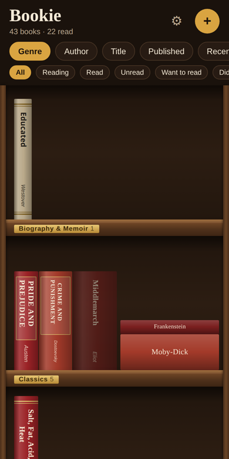

# Bookie


A reading tracker that shows your library as a virtual bookshelf. Swipe along shelves and up and down the bookcase. Book thickness follows page count and height follows the book's physical size. Shelves can be grouped by genre, author, title, publish date or recently read.

**[Try it live → bookie.expo.app](https://bookie.expo.app)** (an early prototype, free, no account)

<p>
  
  &nbsp;
  
</p>

## What it does

- **Real-size books.** Each spine's thickness comes from the page count and its height from the book's physical size. Colours come from the cover's most common colours, with a second colour when the cover has one.
- **Swipe around the shelves.** Sideways along a shelf, up and down the bookcase. Shelves group by genre, author, title, publish date or what you read recently, and long groups are split into ranges (A–D, E–G…) about a screen wide.
- **Track your reading.** Reading, read, unread, want to read, did not finish, with ratings, dates and notes. A book you're reading gets a bookmark.
- **Own it or not.** Books you don't own are faded. Starting a book you wanted asks whether it's on your shelf now.
- **Get books in.** Search, barcode scan, type them in, import a Goodreads export, or start with a sample library. Duplicates can be merged.
- **Keeps your data with you.** Everything is stored on the device in SQLite, with no account and no cloud. Export and restore a backup from Settings.
- **Works as an app.** Runs on the web and can be added to a phone's home screen, and runs in Expo Go.

## Built with

Expo (SDK 58), React Native and Expo Router, TypeScript, SQLite (`expo-sqlite`), Zustand and Reanimated. The shelf engine in `src/shelf/` is plain TypeScript with unit tests (Jest). Pull requests are checked by GitHub Actions, which also deploys to EAS Hosting.

All data stays on the device in SQLite, so use Settings → Export backup to keep a copy. It runs in **Expo Go** (once the SDK 58 Expo Go is out on the stores; until then use a development build) and on the **web**.

## Licence

Source-available, not open source. Bookie is licensed under the [PolyForm Noncommercial License 1.0.0](LICENSE): you're free to read, run, learn from and build on the code for **non-commercial** purposes. You may not use it, or something substantially copied from it, to run a commercial product or service. For anything commercial, get in touch first. Parts that came from Expo's project template stay under their own MIT licence ([LICENSE-EXPO-TEMPLATE](LICENSE-EXPO-TEMPLATE)).

## Run

```bash
npm install
npx expo start        # scan the QR code with Expo Go
npm test              # unit tests (shelf layout, grouping, metadata, Goodreads import)
npx tsc --noEmit && npx expo lint
```

Optional: copy `.env.example` to `.env.local` and set `EXPO_PUBLIC_GOOGLE_BOOKS_API_KEY`. Google Books is a fallback for page counts, genres and book heights, and its keyless quota is often exhausted. Open Library works without a key.

## Deploy the web app

```bash
npm run deploy:staging  # test build at a fixed staging link (the "staging" alias)
npm run deploy:web      # expo export --platform web, then eas deploy --prod (EAS Hosting, free tier)
```

The first deploy asks you to log in to Expo and pick a subdomain. `public/` holds the web shell: `index.html` (manifest and iOS home-screen tags), `manifest.json` and the home-screen icons. On web, only use SQLite's async API (`getAllAsync`, `runAsync`, kv-store `getItem`…): the sync calls need `SharedArrayBuffer`, which needs the cross-origin isolation headers in the `expo-router` plugin in `app.json`. `expo start` sends those headers but EAS Hosting doesn't for this static build, so sync calls would work locally and fail on the live site.

### Moving to a new address

A library lives in the browser, tied to the address it was saved at, so it can't follow people to a new address by itself. To move:

1. Deploy the same build to the new address. Its `/move-in` screen receives libraries.
2. Set the `BOOKIE_NEW_URL` repository variable (Settings → Secrets and variables → Actions → Variables) to the new address, e.g. `https://bookie.example.com`, and deploy to production again.
3. `bookie.expo.app` now shows a "Bookie has moved" banner. **Move my books** opens the new address in a new window and hands the library across with `postMessage` (the same JSON as Export backup, plus the shelf layout). Books already there are skipped and nothing at the old address is deleted, so keep it running for a while.

Each side only accepts messages from the other's exact origin (`src/library/move.ts`). Don't send `Cross-Origin-Opener-Policy` from the new address: it cuts the new window off from the old one. Bookie can only open its library in one tab per address, so the move fails if the new address is already open in another tab; the banner says so. Home-screen icons keep opening the old address, and the new site's move-in screen explains how to add the new one.

For Cloudflare Pages, build with `npm run export:cloudflare`, not a plain `expo export`. `wrangler pages deploy` never uploads files inside a `node_modules` folder, and Expo puts package assets (including SQLite's `wa-sqlite.wasm`) under `dist/assets/node_modules/`. Without them the library can't open. `scripts/prepare-cloudflare.mjs` moves them to `assets/vendor/` and adds a `_redirects` rewrite.

To try it without touching production, build with `EXPO_PUBLIC_OLD_URL=https://bookie--staging.expo.app`, deploy one build with no alias (the "new" site), then build again with `EXPO_PUBLIC_NEW_URL` set to that deploy's address and `eas deploy --alias staging`.

## Continuous integration

`.github/workflows/ci.yml` runs on every pull request into `master` (and on pushes to it):

1. **Tests**: the unit tests. Required to merge.
2. **Build**: the same web export the deploy uses. Required to merge.
3. **Typecheck & lint**: advisory. A failure shows as a red cross on the PR but doesn't have to block merging.
4. **Preview deploy**: after Build, deploys that build to an unnamed EAS Hosting address and posts it on the PR. It's a separate, empty library from the live app, and Expo deletes it after 30 days. It doesn't use one of the 5 named aliases.

5. **Deploy to production**: only on pushes to `master` (a merged PR or a direct push). Waits for Tests and Build, then deploys that build with `eas deploy --prod`. Typecheck & lint doesn't hold it up.

On a PR, the first four run in parallel. `npm run deploy:web` still works for deploying by hand. One-time setup in the GitHub repo (Settings → Secrets and variables → Actions):

- `EXPO_TOKEN` (needed for previews and the production deploy): create one at expo.dev → Account settings → Access tokens. Without it those jobs just skip.
- `GOOGLE_BOOKS_API_KEY` (optional): the same value as in `.env.local`, so preview builds match the live app.

To block merging until the right checks pass: Settings → Branches (or Rules → Rulesets) → protect `master` → require a pull request and require the **Tests** and **Build** status checks. Leave **Typecheck & lint** (and **Preview deploy**) off that list to keep them optional. Check names come from each job's `name:` in the workflow, and a check only appears in the list after it has run once.

## Layout

- `src/shelf/`: pure shelf engine
  - `grouping.ts`: sort modes → groups
  - `spineStyle.ts`: page count → width, size → height, colours
  - `layout.ts`: groups → shelf rows, with bookends and flat stacks
- `src/components/shelf/`: Bookcase → ShelfRow → Spine / BookStack
- `src/services/metadata/`: Open Library + Google Books lookup and genre normalisation
- `src/services/import/goodreadsCsv.ts`: Goodreads export parser
- `src/db/`: SQLite migrations and the books repository
- `src/library/LibraryProvider.tsx`: in-memory library state backed by SQLite
- `src/services/backup.ts`: backup file format (export / restore)
- `src/services/files.ts`: reading picked files and saving the backup on native and web
- `src/library/onboarding.ts`: remembers whether the first-launch walkthrough (`src/app/welcome.tsx`) has been seen
- `assets/icon/bookie-icon.svg`: source artwork for the app icon; the icon PNGs in `assets/images/` and `public/` are rendered from it
- `src/app/`: screens (bookshelf, book detail, add: search / scan / manual / import)
